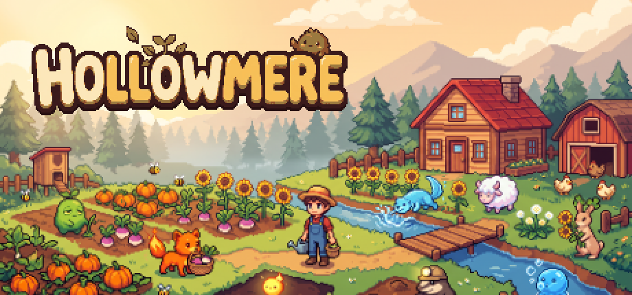
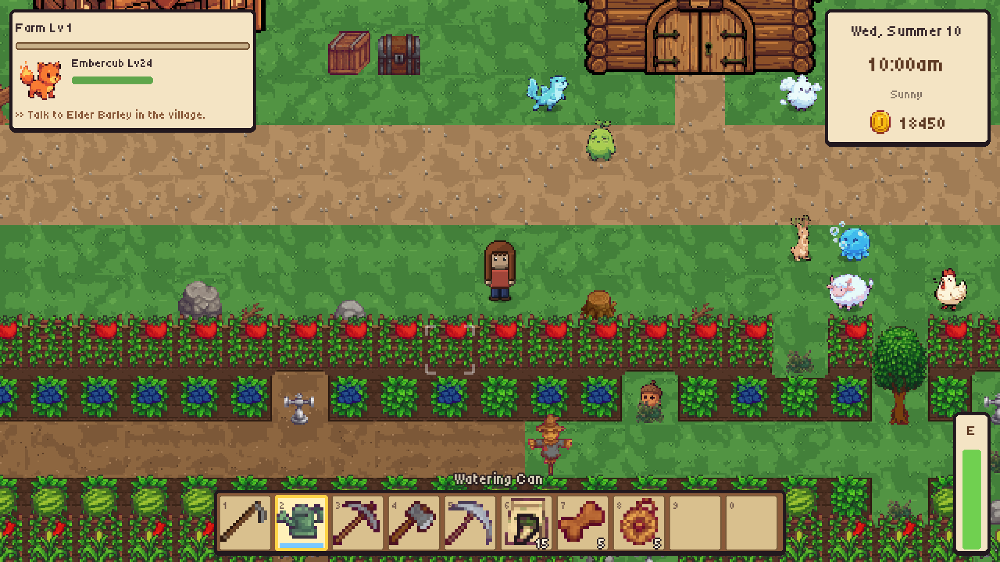
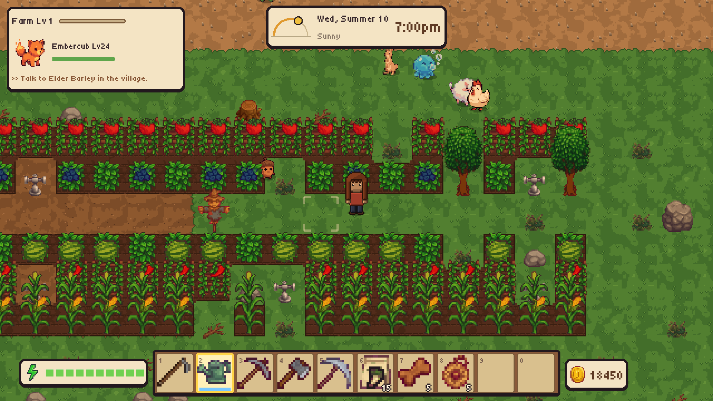
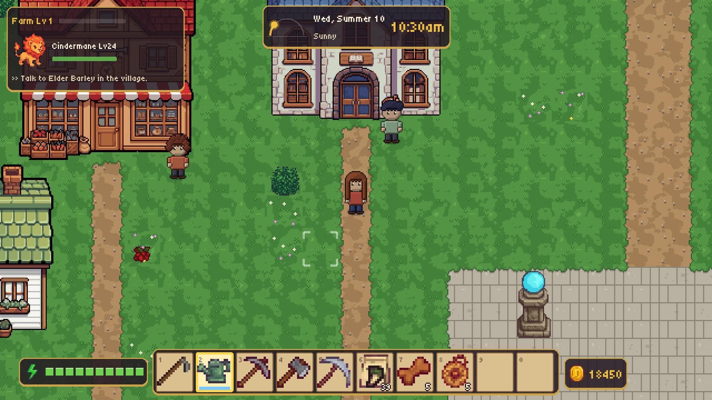
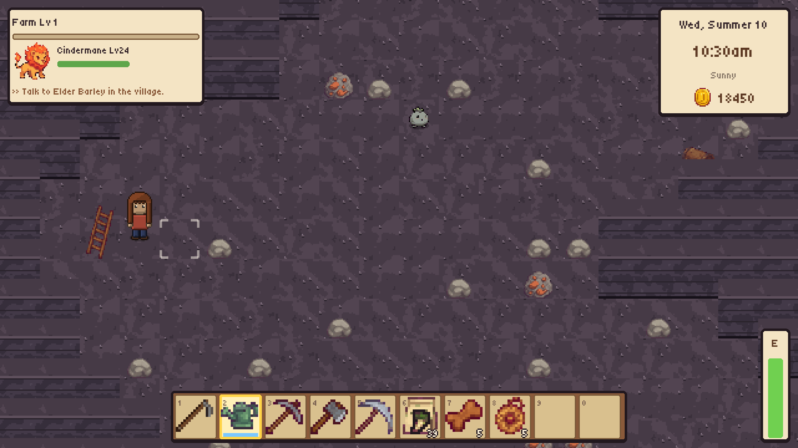
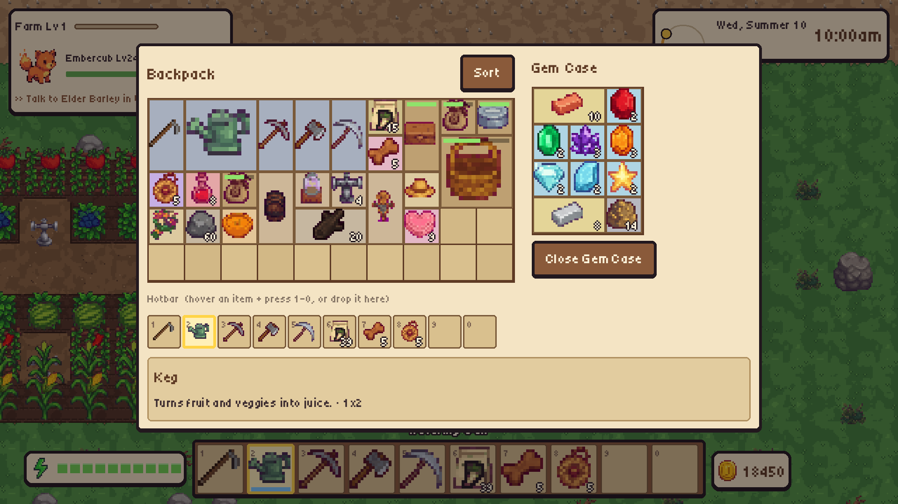
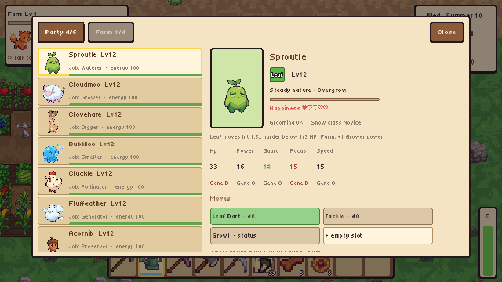
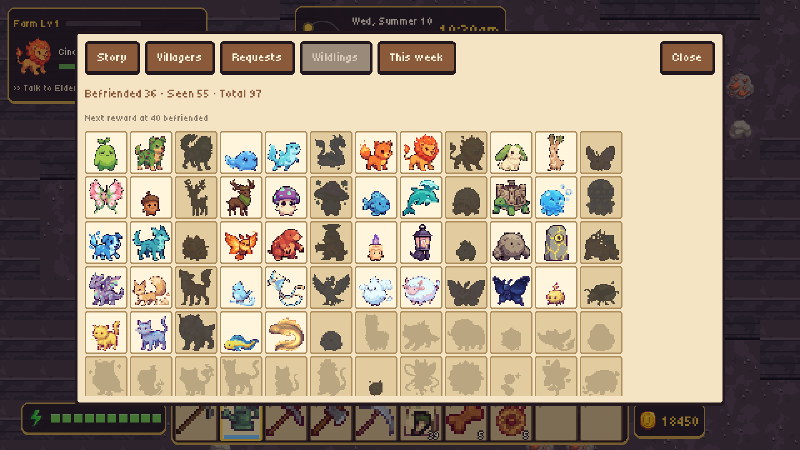

<p align="center">
  
</p>

<h1 align="center">Hollowmere</h1>

<p align="center">
  A cozy Godot 4 farming game where the creatures you befriend live on your farm and work it with you.
</p>

<p align="center">
  <a href="https://github.com/robintrepte/hollowmere/actions/workflows/build.yml?query=branch%3Amain"></a>
  
  
  
  
  
</p>

<p align="center">
  <a href="#play">Play</a> ·
  <a href="#screenshots">Screenshots</a> ·
  <a href="#features">Features</a> ·
  <a href="#run-it-locally">Run locally</a> ·
  <a href="HOSTING.md">Host it</a> ·
  <a href="docs/agents.md">AI helpers</a> ·
  <a href="RELEASE.md">Release</a>
</p>

Inherit your grandmother's overgrown farm in a hidden valley and befriend **106 Wildlings**. They water crops, guard fields and fight beside you in turn-based battles. Farm in real time, fish the coast, mine Eisenkamm, enchant your tools, follow quests, get to know the village, and play together in online co-op — or hand a token to an AI helper.

The same account and cloud saves work in the **browser** (installable home-screen web app), on **Windows** and on **macOS**.

## Screenshots

<p align="center">
  
  
</p>
<p align="center">
  
  
</p>
<p align="center">
  
  
</p>
<p align="center">
  
</p>

## Features

- **106 Wildlings** to befriend, raise, breed and battle
- **10 farm jobs** — watering, growing, clearing, smelting, pollinating, powering machines, preserving, guarding, luck and harvesting, with hourly rates on job cards
- **Real-time farm** — crops, machines, eggs and jobs tick by the clock, including offline (up to 14 days), with seasons from the real calendar
- **Turn-based 1v1 battles** — 10 types, 79 moves, natures, traits, genes and switching
- **Fishing** — cast-and-reel minigame, 48 fish, crab pots, smoker, rod upgrades, and Möwenbucht harbor
- **Mining** — persistent Deep Mine layers under Eisenkamm, plus breakable regional mines, geodes and a museum
- **Enchanting** — table, anvil and grindstone; sixteen tool enchantments with bookshelf boosts
- **Skill tree** — player levels and 110 skills across farming, care, battle, exploration, craft and trade
- **Lumière** — Grand Casino with play-money chips (hideable), boutique, hotel and jukebox
- **Quests** — main story, side, daily and seasonal chains, plus a skippable tutorial
- **A life in the valley** — 40 crops, four seasons, festivals, cooking, crafting, 32 villagers (11 you can court)
- **Nine regions** — each frontier has a Warden, a shrine and a mine
- **Grid inventory** — items take real space, rotate, and nest inside pouches and cases
- **Online co-op** — host-authoritative farms, trading, friendly PvP, emotes and chat bubbles
- **AI helpers** — hosted MCP relay, spectator mode, and up to three virtual farmhands ([setup](docs/agents.md))
- **Play anywhere** — Windows, macOS, mobile browser + Add to Home Screen, full controller support
- **English and German** — pick a language in Settings, or follow the system language

Store copy and capsule art live in [`store/STORE_PAGE.md`](store/STORE_PAGE.md). Age-rating notes: [`store/RATING.md`](store/RATING.md).

## Play

| Build | How |
|---|---|
| Browser | `https://hollowmere.tretu.de` (or host the web export yourself, see [HOSTING.md](HOSTING.md)) |
| Phone | Same URL, landscape. Safari / Chrome → **Add to Home Screen** for fullscreen |
| Desktop | Windows and macOS exports from CI (`v*` tags) or a local Godot export |

Accounts: Tretu-Konto, email, guest, Google, Apple or Discord. Cloud saves and co-op go through Nakama on your own server. AI clients talk to the MCP relay at `mcp.<your-domain>` with a token created in-game.

## Run it locally

Needs **Godot 4.7.2**. Drop the editor at `.tools/Godot.app` (macOS) or put `godot` on your `PATH`.

```bash
# Game only (offline, local saves, no accounts / co-op)
godot --path game
```

Backend (accounts, cloud saves, co-op, MCP): a [Nakama](https://github.com/heroiclabs/nakama/releases) 3.41 binary and a local Postgres, no Docker:

```bash
createdb nakama                                   # once, on your local Postgres
export NAKAMA_BIN=/path/to/nakama                 # from the release tarball
NAKAMA_ALLOW_DEFAULTS=1 NAKAMA_DATABASE_ADDRESS=postgres@127.0.0.1:5432/nakama \
  server/nakama/nakama.sh start                   # migrates, then runs
# API     http://127.0.0.1:7350
# Console http://127.0.0.1:7351  (admin / password, Nakama's dev defaults)
NAKAMA_HTTP_KEY=defaulthttpkey node server/mcp/server.mjs   # MCP relay on :8787 (optional)
```

Then run the game again. `game/project.godot` already points debug builds at `127.0.0.1:7350`.

Server checks (Lua 5.1 and `psql` on PATH):

```bash
luac -p server/nakama/modules/*.lua
lua server/nakama/tests/tretu_test.lua            # signing test vectors, progress, wallet menu, farm choice SQL
server/nakama/nakama.sh check                     # Nakama loads the modules
GODOT=godot node server/nakama/tests/tretu_integration.mjs   # real Nakama + Postgres (drops/creates nakama_test)
                                                  # + the game client against it (without GODOT: skipped)
node server/mcp/test.mjs                          # relay self-test + Tretu webhook unit tests
```

```bash
# Compile check, unit tests, translations, one smoke
godot --headless --path game res://tests/check_scripts.tscn
godot --headless --path game -s addons/gut/gut_cmdln.gd -gconfig=res://.gutconfig.json
python3 tools/content/extract_strings.py --check
godot --path game res://tests/smoke/smoke.tscn
```

Release checklist, signing, itch and Steam: [RELEASE.md](RELEASE.md).

## Host it

Production is `hollowmere.tretu.de` on the Tretu **Hetzner** server: **nginx** for TLS and the static web build, **PM2** for Nakama (`hollowmere-nakama`) and the MCP relay (`hollowmere-mcp`), the `nakama` database on the shared **Postgres**. No Docker. The guide is written for humans and agents: one variable block at the top, then copy-paste commands.

**[HOSTING.md](HOSTING.md)** — DNS, Postgres, Nakama binary, PM2, nginx + certbot, web deploy, Tretu-Konto and platform events, analytics, GitHub Actions, backups, moving off Docker.

## Tretu

Hollowmere is part of the Tretu ecosystem (all optional, off unless configured, see HOSTING.md §10):

- **Mit Tretu-Konto anmelden**: OpenID Connect with PKCE at auth.tretu.de (system browser + loopback on desktop and Steam builds, popup on the web). Earlier Discord (and Steam) players keep their farms; if both a Tretu and an old farm exist, the player picks one in "Wähle deine Farm" and the other is archived, restorable for 90 days.
- **Account deletion reaches the game**: tretu.de's signed webhook (`/api/tretu/webhook`, served by `hollowmere-mcp`) deletes a deleted Tretu-Konto's farms and data, or moves them to the surviving account after a merge, and keeps the Steam link and username current.
- **Tretu menu in the game**: Tretu-Credits balance and unread notifications in the account panel and next to the player's name, with links to tretu.de/wallet and tretu.de/benachrichtigungen (read server-side by Nakama, signed; the app secret never reaches the game).
- **Platform events**: days played, Wildlings befriended and battle results go to tretu.de (stats, badges), plus "playing Hollowmere" presence with a join link while hosting co-op.
- **Legal**: privacy policy, terms and imprint live on tretu.de (`/datenschutz`, `/agb`, `/impressum`).

## Repo map

```
game/          Godot 4.7 project (scenes, data, i18n, tests)
server/        Nakama config + Lua modules (hollowmere.lua, tretu.lua) + tests, MCP relay
deploy/nginx/  nginx sites for hollowmere.tretu.de and mcp.hollowmere.tretu.de
ecosystem.config.cjs  PM2 processes (hollowmere-nakama, hollowmere-mcp)
docs/          Agent MCP setup (docs/agents.md)
store/         Steam / itch capsules, screenshots, rating and store copy
tools/         Art pipeline, string extraction, web fingerprint + precompress
.github/       CI: 413 GUT tests, Lua + Tretu integration tests, Windows / macOS / Web export, tagged deploy
```

CI (every pull request and push to `main`): script compile, GUT, translation template check, 112-day balance sim, casino RTP sim, Lua checks and the Tretu integration test (official Nakama binary, `postgres:16` service, game client included), Nakama integration, co-op and 4-peer desync tests, then Windows / macOS / Web exports, with checksum-verified Godot and Nakama downloads. GitHub Actions must be enabled for the repository (see HOSTING.md §12). Tagged `v*` releases can sign macOS, push itch, rsync the web build and reload PM2.

## Made with

Godot 4, Nakama, pixel art through a small Replicate → quantize → atlas pipeline (`tools/art_pipeline`). Copyright [Robin Trepte](https://github.com/robintrepte). MIT — see [LICENSE](LICENSE).
